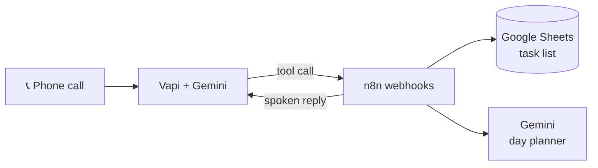
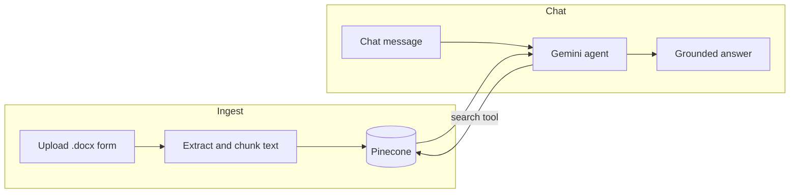
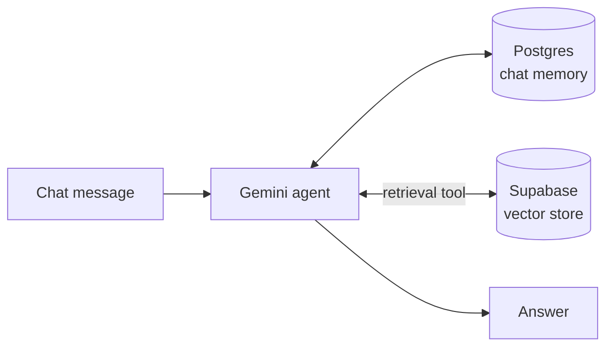

# 🤖 n8n AI Automations

**Voice agents, RAG chatbots and AI workflows built with n8n, Gemini, Vapi, Pinecone and Supabase.**

Built by **Tarun Pediredla**, Full Stack Python & GenAI Engineer.


---

## 📬 Looking to automate something similar? Let's talk.

I build custom AI automations for businesses: voice assistants, document Q&A chatbots and workflow automation. If one of the projects below is close to what you need, I can adapt it to your tools and data.

| | |
|---|---|
| 📧 **Email** | `YOUR_EMAIL@example.com` |
| 💼 **LinkedIn** | `https://linkedin.com/in/YOUR-HANDLE` |
| 🌐 **Portfolio** | `https://YOUR-PORTFOLIO-SITE` |
| 📅 **Book a call** | `https://calendly.com/YOUR-LINK` |

> Typical turnaround for a first working prototype: **days, not weeks**. Message me with a short description of your use case.

---

## 🗂️ Projects

| Project | What it does | Stack | Folder |
|---|---|---|---|
| 🎙️ **Voice Agent: Tasks & Day Planner** | Call a phone number, add tasks by voice, hear your to-do list, get an AI-planned day | n8n · Vapi · Gemini · Google Sheets | [`voice-agent-task-planner`](workflows/voice-agent-task-planner) |
| 📄 **RAG Chatbot: Pinecone + Gemini** | Upload a document, then chat with it. Answers come only from your content | n8n · Pinecone · Gemini | [`rag-pinecone-gemini`](workflows/rag-pinecone-gemini) |
| 🧠 **Knowledge-Base Chat Agent** | Public chat agent with long-term memory and a vector knowledge base | n8n · Gemini · Supabase · Postgres | [`knowledge-base-chat-agent`](workflows/knowledge-base-chat-agent) |

Each folder has a `workflow.json` you can import into n8n and its own README with setup steps.

---

## 🏗️ How they work

### 🎙️ Voice Agent



### 📄 RAG Chatbot



### 🧠 Knowledge-Base Agent



---

## ⚡ Quick start

1. Open your n8n instance, then **Workflows → Import from file**.
2. Pick a `workflow.json` from the `workflows/` folder.
3. Add your own credentials (Gemini, Google Sheets, Pinecone, Supabase or Postgres, depending on the project).
4. Follow the project's README to finish setup, then activate the workflow.

> 🔐 No API keys, tokens or credential IDs are stored in this repo. You connect your own.

---

## 🧰 Tech stack

**Automation:** n8n · Webhooks · Form and Chat triggers
**AI:** Google Gemini · LLM agents with tool use · RAG · embeddings
**Data:** Pinecone · Supabase (pgvector) · PostgreSQL · Google Sheets
**Voice:** Vapi (phone number + speech) with an upgrade path to Gemini Live
**Languages:** Python · JavaScript/TypeScript

---

## 💼 What I can build for you

- 🎙️ **Voice assistants** for booking, support, reminders and lead capture
- 📄 **Document Q&A bots** over your PDFs, docs and internal knowledge
- 🔗 **Workflow automation** connecting your CRM, sheets, email, Slack and databases
- 🧩 **Custom AI agents** with memory, tools and guardrails
- 🚀 **Full-stack delivery**: backend APIs (Python), web front end, deployment

---

## 📁 Repo structure

```
n8n-ai-automations/
├── README.md
├── LICENSE
├── .gitignore
└── workflows/
    ├── voice-agent-task-planner/
    │   ├── workflow.json
    │   └── README.md
    ├── rag-pinecone-gemini/
    │   ├── workflow.json
    │   └── README.md
    └── knowledge-base-chat-agent/
        ├── workflow.json
        └── README.md
```

---

## 📄 License

MIT. Free to use and adapt. If this saved you time, a ⭐ helps others find it.
