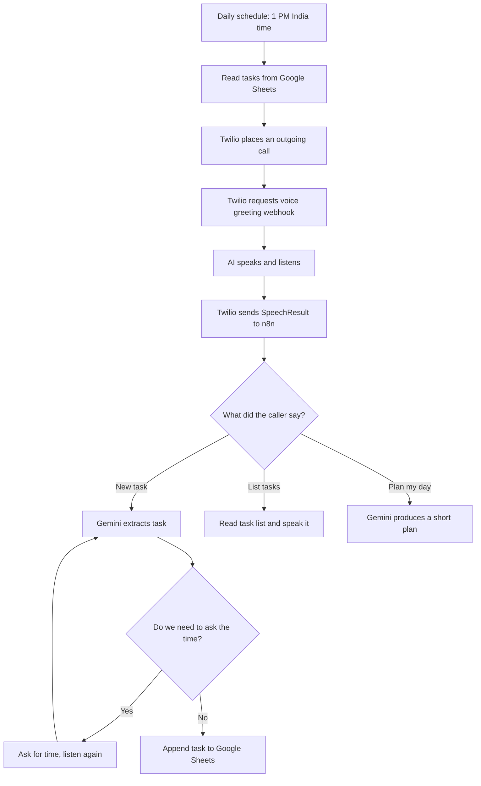

# AI Voice Task Planner — Twilio + Gemini + Google Sheets

**A phone call that listens to your tasks, saves them, reads your to-do list, and can plan your day.**

This folder contains a **sanitized copy of my real 35-node n8n workflow**. It is a learning project, not a ready-to-run phone service. You must add your own accounts and settings before switching it on.

## What does it do? (Very simple explanation)

Imagine a helpful assistant who calls you and asks, “What do you need to do?” You say, “Prepare Python interview questions.” The assistant can ask “At what time?” You answer “4 PM.” It saves the task in a Google Sheet and says it was added.

| Tool | Simple meaning | Why we need it |
| --- | --- | --- |
| **n8n** | A set of connected boxes that do the work | Runs the steps in order |
| **Twilio** | The telephone service | Makes the actual phone call and turns speech into text |
| **Gemini** | The AI brain | Understands your words and creates a day plan |
| **Google Sheets** | A notebook | Saves your task list |

**Important:** This specific project uses **Twilio speech Gather**, not Vapi. There is another Vapi example in the parent repository.

## How the project works

## 1. First, get everything ready

1. Make an account on [n8n](https://n8n.io) and open the workflow editor.
2. Create a [Twilio](https://www.twilio.com) account. Get a voice-enabled Twilio phone number, if eligible. Trial accounts often only call verified numbers and have limits; real calls can cost money.
3. Open [Google AI Studio](https://aistudio.google.com) and create a Gemini API key.
4. Create a Google Sheet with a tab called **Tasks**.
5. Check that your Google account can connect to n8n through **Google Sheets OAuth2**.

**Never put real API keys, phone numbers, Twilio tokens, private Google Sheet IDs, or credential IDs in a public GitHub repository.** This example has those removed.

## 2. Make the task sheet

Create **exactly these eight column headers** in row 1 of the `Tasks` tab:

| Task ID | Task Title | Description | Due Date | Time | Priority | Status | Created At |
| --- | --- | --- | --- | --- | --- | --- | --- |

Example: `T-101 | Study Python | Revise loops | 2026-10-30 | 16:00 | High | Pending | 2026-10-29 13:00:00`

**Why?** Google Sheets needs these header names so the n8n **Append Task Row** node knows where to save each value.

## 3. Import the workflow into n8n

1. Download [workflow.json](workflow.json) from this folder.
2. In n8n, create a new workflow and choose **Import from File** from the editor menu.
3. Select `workflow.json`.
4. You will see about **35 nodes**. Nodes are simply instructions: one reads a sheet, one asks Gemini, one calls Twilio.
5. **Do not activate yet.** First replace the sample values described below.

> If you already have a live voice planner in your n8n account, import into a **new workflow**. Do not overwrite the live workflow while experimenting.

## 4. Connect your Google Sheet

Open each of these nodes and select **your Google Sheets OAuth2 credential**:

- `Read Tasks For Call`
- `Read Tasks For Greeting`
- `Read Tasks For List`
- `Read Tasks For Plan`
- `Append Task Row`

In **Document**, replace `YOUR_GOOGLE_SHEET_ID` with your own spreadsheet/document. In **Sheet**, choose `Tasks`. In **Append Task Row**, map all eight columns using the existing expressions.

**Why?** Without the correct sheet and account, the assistant may speak but cannot save or find tasks.

## 5. Connect Gemini (AI)

Open **Extract Task** and **Gemini Plan Day**.

1. Add your Gemini credential/API key using n8n's supported Gemini credential option.
2. Choose an available Gemini model from the dropdown (models and quotas can change).
3. Keep the task-extraction instructions: return task `title`, `description`, `dueDate`, `time`, and `priority`.
4. Keep the day-planning instruction to use only tasks actually found in your sheet.

**Why?** **Extract Task** understands the new task. **Gemini Plan Day** helps organize pending tasks.

## 6. Connect Twilio and replace the sample values

Open **Make Twilio Call** (HTTP Request node).

- **Method:** POST.
- **URL:** `https://api.twilio.com/2010-04-01/Accounts/YOUR_TWILIO_ACCOUNT_SID/Calls.json`
- **Authentication:** use your own **Twilio credential** in n8n, not a hard-coded secret.
- **Body content type:** `form-urlencoded`
- **To:** `YOUR_VERIFIED_PHONE_NUMBER` — the number that should receive calls, using international format, like `+91...`.
- **From:** `YOUR_TWILIO_PHONE_NUMBER` — your Twilio voice-capable number.
- **Url:** `https://YOUR_N8N_DOMAIN/webhook/voice-greeting`

**Why?** Twilio must know who to call, which phone number to call from, and where to ask for the spoken greeting.

On a Twilio trial plan, verify the recipient number in Twilio first. Some numbers or destinations may not be available. Do not try repeatedly if you see a billing/permission error.

## 7. Update the voice webhook addresses

The workflow has **two webhooks**:

| n8n node | URL |
| --- | --- |
| `Webhook Morning Greeting` | `https://YOUR_N8N_DOMAIN/webhook/voice-greeting` |
| `Webhook Twilio Voice` | `https://YOUR_N8N_DOMAIN/webhook/voice-task` |

For **both** nodes, use **HTTP POST** and **Respond using Respond to Webhook node**.

Replace the text `YOUR_N8N_DOMAIN` with the real public hostname of your n8n instance **everywhere in the workflow**, including the JavaScript code in **Build Morning Greeting** and **Build Time Prompt** and the response nodes **Respond Add Reply**, **Respond List Reply**, and **Respond Plan Reply**.

A reliable method is to use **the production webhook URL displayed by n8n** for each webhook. The callback address must be public and use HTTPS. Check the `action` value in each speech `<Gather>` response.

**Why?** A call might start but then fail to add a task if Twilio cannot send its recognized speech back to your webhook.

## 8. Keep the voice conversation connected

These are the most useful nodes to understand:

| Node | What it does |
| --- | --- |
| `Route Speech` | Decides if the caller wants to add, list, or plan |
| `Extract Task` | Gemini pulls out the task's name and details |
| `Parse Task JSON` | Validates the AI answer and prepares sheet values |
| `Input Valid?` | Blocks empty or untrusted task names |
| `Ask For Time?` | Checks whether more information is needed |
| `Build Time Prompt` | Asks the caller for a time and passes task context to the next speech callback |
| `Append Task Row` | Writes the new task to Google Sheets |
| `Say Task Added` | Confirms the save |
| `Is List Request?` | Checks for a task-list request |
| `Format Spoken Task List` | Prepares a short voice summary |
| `Gemini Plan Day` | Builds a short day plan |

**Example conversation:**

- Assistant: “Tell me a task.”
- Caller: “I want to prepare Python interview questions.”
- Assistant: “At what time?”
- Caller: “At 4 PM.”
- Assistant: “Done. I added your task for 4 PM.”

The voice callback carries a temporary task title in the action URL so n8n can combine the second sentence with the first. This is a simple demo mechanism; for production, use server-side call-session storage rather than putting private task text in a URL.

## 9. Set the automatic call time

Double-click **Morning Call Schedule**.

- Trigger Interval: **Days**
- Days Between Triggers: **1**
- Trigger at Hour: **13**
- Trigger at Minute: **0**
- Workflow timezone (**Settings**): **Asia/Kolkata**

**13:00 in 24-hour time means 1:00 PM.**

**Important:** When this workflow is active, scheduled calls can use Twilio credits and may incur charges. Change the daily schedule or disable this node if you do not want automatic calls.

## 10. Test in a safe order

1. **Sheets read:** Execute `Read Tasks For List` and check for the data in your sheet.
2. **Gemini:** Verify `Extract Task` returns a task name matching the spoken words.
3. **Voice callback:** Test a POST webhook with a field called `SpeechResult`.
4. **Task save:** Test with a *deliberately fake test task*, then check that **only one row** was added to the sheet. Remove the test row after checking.
5. **Twilio call:** After all steps pass, run **Make Twilio Call** once and answer your phone.
6. **Live full call:** Say a short task, answer the follow-up time question, hear the confirmation, and check the sheet.
7. **Publish/activate:** Use **Publish** so the production webhooks and daily calling schedule are running.

Do not confuse **workflow execution succeeded** with **the task was really saved**. Check **Append Task Row** *and* the actual sheet.

## 11. Easy fixes when something goes wrong

| Problem | Check this |
| --- | --- |
| Call never rings | Twilio credential, trial verified number, From/To, account balance, execution log |
| Call connects but hears no greeting | Voice greeting production webhook, HTTPS, `Respond Morning Greeting` |
| AI does not understand the task | `Webhook Twilio Voice` input `SpeechResult`, `Route Speech`, and Gemini output |
| AI forgets the time | `Build Time Prompt` action URL, `pendingTitle` query, `Parse Task JSON` |
| Task is spoken but not saved | `Input Valid?`, `Append Task Row`, sheet name, permissions and column mapping |
| Bad Request 400 | Twilio body parameters, phone numbers, trial restrictions, authenticated request |
| Workflow works in manual test but not during calls | Use **production** webhook URLs and **Publish** |
| Call ends after one response | Check `<Gather>` and `Respond to Webhook` nodes; Twilio needs valid TwiML XML |

## 12. Important safety notes

- The workflow file has **no real API keys, credential IDs, personal phone numbers, Twilio Account SID, n8n hostname or private Sheet ID**. You must supply your own.
- This public example is for learning; before production, validate that incoming Twilio webhook requests genuinely come from Twilio (for example via request-signature verification through an appropriate gateway).
- The current task follow-up passes task information in a query string; this may appear in logs. Prefer server-side, short-lived session state for sensitive data.
- Use n8n's saved execution data carefully: spoken tasks can contain personal details.
- Gemini and Twilio may have usage limits or charges. **Not everything is always free.**
- The current workflow is an automated **outgoing** phone-call planner, not a general incoming-call contact center.

## Folder files

- [`workflow.json`](workflow.json) — the importable, sanitized 35-node n8n workflow.
- [`README.md`](README.md) — this beginner guide.

**Remember:** GitHub stores your project files; n8n actually runs the automation. Editing GitHub does not automatically change your live n8n workflow.
