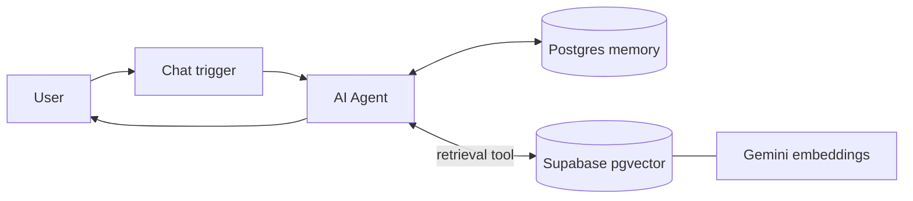

# 🧠 Knowledge-Base Chat Agent

A public chat agent with **conversation memory** and a **vector knowledge base**. It remembers earlier messages in the session and pulls relevant documents from Supabase when it needs facts.

## Components

| Piece | Role |
|---|---|
| Chat trigger (public) | Hosted chat widget with a custom greeting |
| AI Agent | Orchestrates the conversation and decides when to look things up |
| Google Gemini Chat Model | The language model |
| Postgres Chat Memory | Keeps conversation history per session |
| Supabase Vector Store (retrieve-as-tool) | Semantic search over your documents |
| Embeddings Google Gemini | Turns queries into vectors for the search |

## Architecture

## Setup

1. **Supabase:** enable the `pgvector` extension and create a documents table with the match function used by n8n's Supabase Vector Store node. See the [n8n Supabase vector store docs](https://docs.n8n.io/integrations/builtin/cluster-nodes/root-nodes/n8n-nodes-langchain.vectorstoresupabase/).
2. **Fill the knowledge base:** load your documents into that table, using the same Gemini embedding model that the workflow uses for search.
3. **Import** `workflow.json` into n8n.
4. Attach credentials: **Google Gemini** (chat model and embeddings), **Postgres** (memory) and **Supabase** (vector store).
5. In the `Supabase Vector Store` node, select your documents table.
6. Activate the workflow and open the public chat URL.

## Customize

- Edit the greeting in the chat trigger.
- Add a system message to the agent to set tone, scope and guardrails.
- Add more tools to the agent (CRM lookup, email, calendar) to turn it into an action-taking assistant.

## Good fit for

Website support bots, onboarding assistants, internal helpdesks, sales-enablement Q&A.
