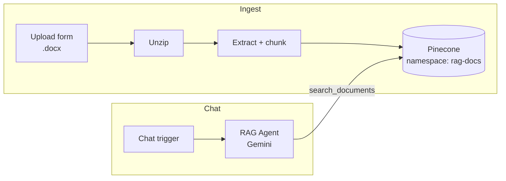

# 📄 RAG Chatbot: Pinecone + Gemini

Upload a document, then chat with it. The agent answers **only from your content** and says so when it can't find an answer.

## What it does

1. **Ingest:** a web form accepts a `.docx` file. The workflow extracts the text, splits it into overlapping chunks (1,000 characters with 200 overlap) and upserts them into Pinecone.
2. **Chat:** a chat interface sends questions to a Gemini agent. The agent calls a `search_documents` tool (top 5 matches from Pinecone) and answers from the returned passages.

## Architecture

## Setup

1. **Pinecone:** create an index with **integrated embeddings** and map the text field to `chunk_text`. Copy the index host URL.
2. **Import** `workflow.json` into n8n.
3. In the `Add to Pinecone` and `search_documents` nodes, replace `https://YOUR-INDEX-HOST.svc.YOUR-REGION.pinecone.io` with your index host and attach a **Pinecone** credential.
4. Add a **Google Gemini (PaLM)** credential to the `Gemini Chat Model` node.
5. Activate the workflow. Upload a document through the form URL, then open the chat.

## Customize

| Want to... | Change |
|---|---|
| Use a different chunk size | `chunkSize` and `overlap` in the `Prepare Chunks` node |
| Return more context | `top_k` in the `search_documents` node |
| Change the bot's behavior or tone | System message in the `RAG Agent` node |
| Support PDF or TXT | Replace the unzip and chunk steps with n8n's *Extract From File* node |

## Known limitations

- The ingestion path currently reads `.docx` files only.
- Chunking is character-based. Switching to paragraph or semantic chunking would improve quality on long documents.

## Good fit for

Internal knowledge bases, HR and policy Q&A, product documentation bots, customer support deflection.
