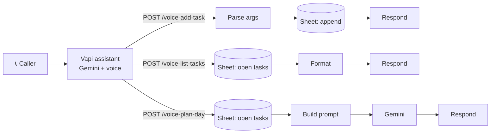

# 🎙️ Voice Agent: Tasks & Day Planner

Call a phone number, talk to an AI assistant, and manage your to-do list by voice. It can also plan your day.

This workflow is the **backend** for a Vapi voice assistant. Vapi handles the phone call and speech. Gemini handles the conversation. n8n exposes three webhooks that Vapi calls as tools.

## What it can do

| Say something like... | Tool called | What happens |
|---|---|---|
| "Add a task: send the invoice, high priority, due Friday" | `voice-add-task` | Saves the task to Google Sheets |
| "What's on my list?" | `voice-list-tasks` | Reads open tasks and speaks them back |
| "Plan my day, I wake at 7 and have 8 hours" | `voice-plan-day` | Gemini builds a time-blocked schedule from your open tasks |

## Architecture

## Setup (all free tiers)

1. **Google Sheet**: create `Voice Agent Tasks` with a tab named `Tasks` and these headers in row 1: `id | task | priority | due | status`
2. **Gemini key**: get one at [aistudio.google.com](https://aistudio.google.com). In n8n, create a **Header Auth** credential named `x-goog-api-key` with your key as the value.
3. **Import** `workflow.json` into n8n, then select your Google Sheets credential and sheet in the three Sheets nodes. Attach the Header Auth credential to the `Gemini - Plan Day` node.
4. **Activate** the workflow and copy the three **production** webhook URLs.
5. **Vapi** ([vapi.ai](https://vapi.ai)): create an assistant (model: Google Gemini), add three tools pointing at those URLs, then attach a phone number.
6. Call the number.

### Tool parameters for Vapi

| Webhook | Parameters |
|---|---|
| `voice-add-task` | `task` (string), `priority` (low/medium/high), `due` (string) |
| `voice-list-tasks` | none |
| `voice-plan-day` | `wake_time` (string), `available_hours` (number) |

## Upgrade path

Vapi uses a text LLM plus text-to-speech. For native audio-to-audio with **Gemini Live**, bridge phone audio over a WebSocket (Twilio Media Streams with Pipecat or LiveKit Agents) and keep this workflow as the tool backend.

## Good fit for

Appointment booking, reminders, lead capture, support triage, or any "talk to my systems" voice use case.
